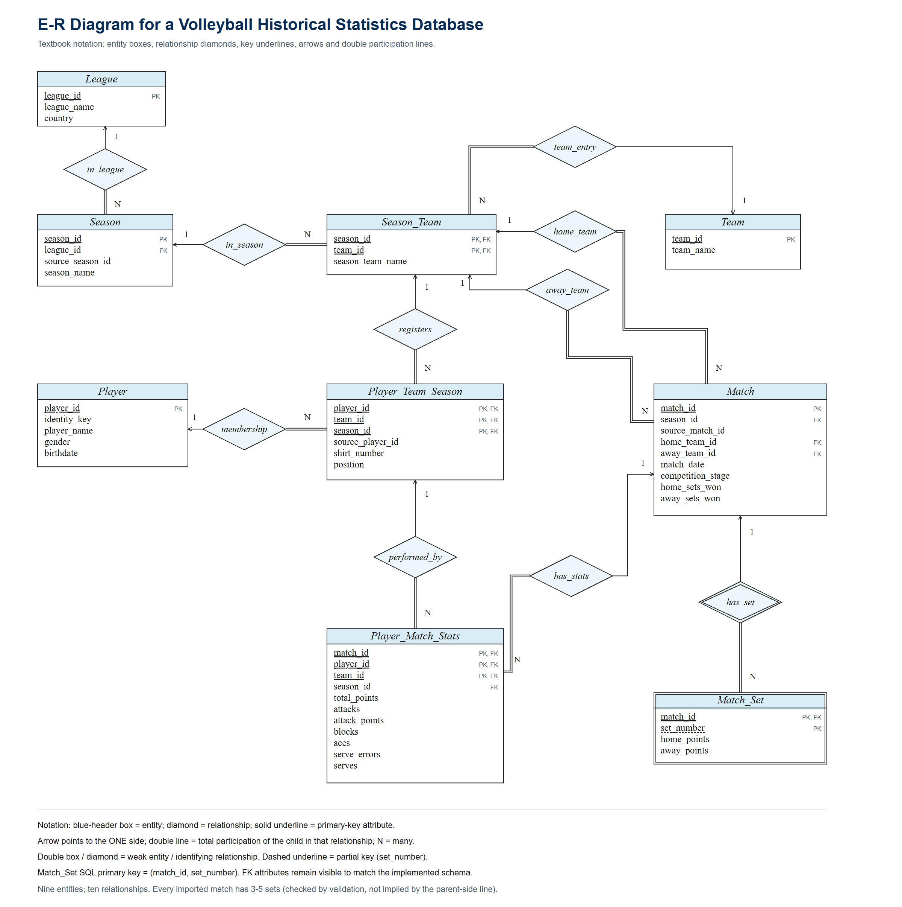
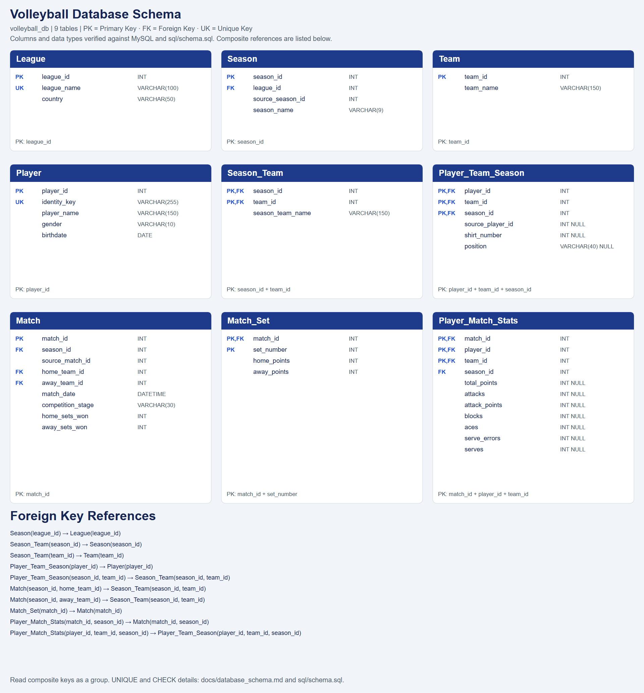

# 排球歷史賽事與球員數據管理系統

**第一次看這個專題，先讀第 1、2、3 節，再看 [上台報告小抄](docs/report_guide_zh.md)。**

這是一個 Database Systems 期末專題：用 **Python 整理真實歷史資料 → 存進 MySQL → 用 SQL 回答五個排球問題**。

GitHub：[PearcePin/volleyball-database](https://github.com/PearcePin/volleyball-database)

## ER Diagram 與 Database Schema（直接看圖）

**ER Diagram：** 採老師範例的課本畫法：淡藍表頭的實體長方形、菱形關係、底線主鍵、指向「一」端的箭頭，以及表示完全參與的雙線。雙框 Match_Set 是弱實體。



[放大 ER 圖 SVG](diagrams/er_diagram.svg) · [課本符號圖例與關聯說明](diagrams/er_diagram.md)

**Database Schema：** 看九張表各有哪些欄位、資料型別、主鍵，以及複合外鍵指向哪裡。



[放大 Schema 圖 SVG](diagrams/database_schema.svg) · **[逐表欄位、PK/FK、選鍵原因](docs/database_schema.md)** · [可執行建表 SQL](sql/schema.sql)

兩張圖的差別：ER 圖用連線解釋關係；Schema 圖列出實際儲存結構。Schema 說明與圖表由實際 MySQL 結構產生，並核對 schema.sql。

## 1. 這個專題到底在幹嘛？

想像你有很多張比賽紀錄表。每張都寫球隊、球員、日期、比分，很容易重複或弄混。我們把不同類型的資料分開存，用「編號」連起來。

例如：「某球員在某年替某隊出賽」，不是只把隊名寫在球員旁邊。因為他明年可能轉隊，我們另開一張表保存每年的球隊紀錄。這樣查歷史時，舊資料不會被新隊名覆蓋。

**專題沒有做網站，重點是資料庫、資料整理、SQL 分析與設計文件。** 你可以用 VS Code 看程式和文件，用 PowerShell 執行。

## 2. 已經完成的內容與真實規模

這台電腦已經實際完成安裝依賴、啟動 MySQL、建表、匯入、重複匯入測試、資料驗證與全部查詢。資料來自 [volleystat](https://github.com/bozhinvi/volleystat)，包含德國男女聯賽 2013–2014 到 2018–2019 六季，沒有編造比賽或數據。

| 資料表 | 真正匯入筆數 | 白話意思 |
|---|---:|---|
| League | 2 | 男子、女子聯賽 |
| Season | 12 | 男女各六季 |
| Team | 32 | 跨季識別的球隊 |
| Player | 940 | 依來源姓名、性別、生日解析的球員身分 |
| Season_Team | 137 | 某隊參加某季 |
| Player_Team_Season | 1,853 | 某球員在某季屬於某隊 |
| Match | 1,696 | 真正的比賽場數 |
| Match_Set | 6,330 | 各場每局比分 |
| Player_Match_Stats | 32,483 | 可對應球員名冊的單場統計 |

原始球員統計 32,755 筆，去除 4 筆完全重複，再隔離 268 筆找不到名冊的紀錄，得到 32,483 筆。隔離資料仍保留，不會補假球員。球員排行榜可能因此低估完整表現；比賽與五局比例使用全部 1,696 場比賽。

驗證結果：[validation_results.json](docs/validation_results.json)。十項檢查的錯誤數都是 0。

## 3. 你應該先開哪些檔案？

| 你想做什麼 | 打開哪個檔案 |
|---|---|
| 看懂專題、練習上台 | [report_guide_zh.md](docs/report_guide_zh.md) |
| 交英文企劃書 | [proposal_en.md](docs/proposal_en.md) |
| 看企劃書中文說明 | [proposal_zh.md](docs/proposal_zh.md) |
| 展示 ER 圖 | [er_diagram.png](diagrams/er_diagram.png) 或 [SVG](diagrams/er_diagram.svg) |
| 看五個查詢的真實結果 | [query_results.md](docs/query_results.md) |
| 看真正執行的 SQL | [queries.sql](sql/queries.sql) |
| 看每張表怎麼建立 | [schema.sql](sql/schema.sql) |
| 解釋來源、缺值、隔離與限制 | [data_sources.md](docs/data_sources.md) |
| 看所有原始欄位的意思 | [raw_data_dictionary.md](docs/raw_data_dictionary.md) |

VS Code 裡開 `.md` 後，按 **Ctrl+Shift+V** 就能看排版後的 Markdown 預覽。圖片直接點開；不需要另外裝 MySQL Workbench 才能報告。

## 4. 這台電腦：重新開機後如何執行

在 VS Code 選「Terminal → New Terminal」，使用 PowerShell。先切到專案：

```powershell
Set-Location "$HOME\Desktop\資料庫作業\volleyball-database"
python scripts/setup_local_mysql.py
python scripts/validate_data.py
python scripts/run_queries.py
```

一行一行執行即可。第一行啟動這個專題專用的 MySQL；如果已啟動就直接沿用。第二行檢查資料是否正確；第三行執行五個查詢，把結果輸出到 `docs/query_results.md` 和 `docs/query_results/*.csv`。

**不需要每次重新下載或匯入。** 資料庫已經保存在本機。MySQL 使用 `127.0.0.1:3307`，只監聽本機；它不是 Windows 自動啟動服務，重新開機後先執行 setup。

若你修改了清理程式，才需要重新匯入：

```powershell
python scripts/import_data.py
python scripts/validate_data.py
python scripts/run_queries.py
```

## 5. 換一台 Windows 電腦：從零開始

### 5.1 檢查 Python 與 pip

```powershell
python --version
python -m pip --version
git --version
```

建議 Python 3.11。這台原本就有 Python 3.11.9 與 Git；`pip.exe` 被 Windows 應用程式控制阻擋，但 **`python -m pip` 可以正常執行**，因此以下都用這個寫法。

如果沒有 Python，可用官方 Python 安裝程式，安裝時勾選 Add Python to PATH；或使用 PowerShell：

```powershell
winget install --exact --id Python.Python.3.11
winget install --exact --id Git.Git
```

安裝後關掉終端機再開一次。若 `python` 叫不出來，可試 `py -3.11`，並用它替換下面指令的 python。

### 5.2 下載專案、安裝套件

```powershell
git clone https://github.com/PearcePin/volleyball-database.git
Set-Location volleyball-database
python -m venv .venv
.\.venv\Scripts\python.exe -m pip install -r requirements.txt
```

接下來把範例中的 `python` 換成 `.\.venv\Scripts\python.exe`，即可使用虛擬環境，不必修改 PowerShell 執行原則，也不必執行 Activate.ps1。若學校電腦禁止執行虛擬環境的 exe，改用允許的 Python：`python -m pip install -r requirements.txt`。

| 套件 | 負責什麼 |
|---|---|
| pandas | 讀 CSV、合併、清理與統計 |
| SQLAlchemy | 建立資料庫連線、交易與匯入 |
| PyMySQL | 讓 Python 與 MySQL 溝通 |
| python-dotenv | 從本機 .env 讀密碼 |
| rdata | 把 R 的 RDA 轉成可用資料，不用裝 R |
| numpy、cryptography | 資料處理與 MySQL 驗證所需依賴 |

### 5.3 準備 MySQL

最簡單的方式是執行內附腳本：

```powershell
python scripts/setup_local_mysql.py
```

它會下載官方 MySQL 8.4.13 Windows ZIP（約 270 MB），放在 `%LOCALAPPDATA%\volleyball-mysql`；資料庫檔案放在該目錄的 `db`。不用管理員權限，不建立 Windows 服務，不修改原有 3306 埠的 MySQL。第一次初始化後立即設定隨機 root 密碼，並建立只對 `volleyball_db` 有權限的 `volleyball_user`。

專題連線資料存在本機 `.env`，管理員備援密碼存在 `.runtime/admin.env`。**兩者都由 .gitignore 排除，不上傳 GitHub。不要把它們放在報告截圖。** `.env.example` 只是設定範例，不是真密碼。這台已經設定好了，請不要用範例覆蓋現有 `.env`。

若你已有自己的 MySQL 8.x，也可以不用下載腳本：複製 `.env.example` 為 `.env`，用 VS Code 填入自己的帳號、密碼與埠號，資料庫名稱維持 volleyball_db。該帳號需要建立此資料庫與資料表的權限。使用 MySQL 8.0.16 以上才會真正強制執行 CHECK；本專題實際測試版本為 8.4.13。

官方安裝說明：[MySQL Windows installation](https://dev.mysql.com/doc/refman/8.4/en/windows-installation.html)。若學校電腦缺 Visual C++ Runtime，可安裝微軟官方套件後再試：

```powershell
winget install --exact --id Microsoft.VCRedist.2015+.x64
```

### 5.4 完整重建流程

專案已附真實 raw CSV 與 RDA，所以換電腦可以直接從匯入開始。想重新從固定上游版本下載，先執行 download：

```powershell
python scripts/download_data.py
python scripts/import_data.py
python scripts/validate_data.py
python scripts/run_queries.py
```

`import_data.py` 會先建立 `schema.sql` 中的資料庫與九張表，再清理與匯入。順序是 League、Season、Team、Player → 球隊與球員的季別關聯 → 比賽、局數、單場統計。同一批資料重跑不會新增副本。

只想清理 CSV、不想連 MySQL：

```powershell
python scripts/import_data.py --prepare-only
```

### 5.5 停止本專題 MySQL

```powershell
python scripts/stop_local_mysql.py
```

這會正常關閉本專題伺服器，不會刪除資料。要再開啟就執行 setup。

## 6. 五個查詢怎麼換參數？

打開 `sql/queries.sql`，最上面有四個 SET：

```sql
SET @season_id = 101819;
SET @player_id = 848;
SET @team_a = 1002;
SET @team_b = 1016;
```

- `101819`：男子 2018–2019。男子季別是 100000＋來源四位季別；女子是 200000＋來源季別。例如女子 2018–2019 是 `201819`。
- `848`：本固定版本識別表裡的 Robert Kromm。其他人請查 `data/processed/Player.csv`；ID 不是球衣號碼。
- `1002`：Berlin Recycling Volleys；`1016`：VfB Friedrichshafen。其他球隊見 `Team.csv`。

改完存檔，重新執行 `python scripts/run_queries.py`。程式產生的報告會自動記錄實際 SET 參數。也可以在 MySQL Workbench 打開整個 queries.sql 執行，得到相同查詢。

Q5 拆成兩份結果：`q5a.csv` 是每場明細，`q5b.csv` 是各季比例。這仍是同一個「五局大戰分析」題目，因此總共五個題目、六份結果。

## 7. 資料夾與每支程式在做什麼

```text
volleyball-database/
├── data/raw/             原始 RDA、完整欄位 CSV、來源說明與 SHA-256
├── data/processed/       九張整理後 CSV、身分對照、隔離與重複紀錄
├── sql/schema.sql        建立九張表、PK、FK、UNIQUE、CHECK
├── sql/queries.sql       五個分析問題的 MySQL SQL
├── scripts/
│   ├── common.py         共用路徑、.env 與資料庫連線
│   ├── download_data.py  下載固定版本，正確轉換 R 日期及匯出 CSV
│   ├── import_data.py    清理、整理關聯、交易匯入、顯示筆數
│   ├── validate_data.py  檢查外鍵、比分、局數與統計
│   ├── run_queries.py    實際執行 SQL，輸出 Markdown 與 CSV
│   ├── setup_local_mysql.py  安裝／啟動本機專用 MySQL
│   ├── stop_local_mysql.py   正常關閉本機專用 MySQL
│   ├── generate_chen_diagram.py  產生課本格式的 ER 圖
│   └── render_diagram.py     輸出課本格式 SVG、PNG
├── diagrams/             課本格式 ER 圖、Schema 圖、Mermaid 對照原始碼
├── docs/                 雙語企劃書、報告小抄、欄位說明、驗證及查詢結果
├── requirements.txt      Python 套件清單
├── .env.example          不含真實密碼的設定範例
├── .gitignore            排除密碼、暫存檔與虛擬環境
└── README.md             你現在看的使用說明
```

`data/raw` 是來源證據，`data/processed` 是整理結果，MySQL 才是實際執行 SQL 的地方。CSV 不是拿來冒充資料庫執行結果。

## 8. 四個最重要的資料庫觀念

1. **Primary Key（PK，主鍵）**：每列的唯一編號。像學號，每個人不能撞號。
2. **Foreign Key（FK，外鍵）**：指向另一張表已存在的編號。比賽不可以指向不存在的球隊。
3. **複合主鍵**：多個欄位合起來才唯一。例如「比賽＋第幾局」，因每場都有第一局。
4. **正規化**：把不同事物拆開，避免重複與更新矛盾。例如改隊名不必改數萬筆球員統計。

本專題核心接近 3NF，但統計表保留可由 match_id 推得的 season_id，目的是用複合外鍵保證賽季一致。報告時誠實說「核心正規化，保留少量受約束冗餘」，不要說完全每張都符合 3NF。

## 9. 常見問題

**Connection refused / 2003：** MySQL 還沒開，先執行 setup。確認 `.env` 埠號是這個專題的 3307。啟動失敗查看 `%LOCALAPPDATA%\volleyball-mysql\db\mysql-error.log`。

**Access denied / 1045：** 帳號、密碼或埠號不正確。用 VS Code 檢查本機 `.env`；不要把密碼貼到公開 GitHub。若你使用既有 MySQL，填入你自己的設定。

**ModuleNotFoundError：** 目前的 Python 沒安裝套件。執行 `python -m pip install -r requirements.txt`；確認執行與安裝使用同一個 Python。

**pip.exe 被封鎖：** 改用 `python -m pip`。這次 pyreadr 的原生 DLL 也遭 Windows 應用程式控制封鎖，因此改用 rdata，不需要關閉 Windows 防護。

**中文或特殊姓名在終端機看起來怪怪的：** 文件與 CSV 都是 UTF-8，請用 VS Code 開啟；CSV 結果另外有 UTF-8 BOM，方便 Excel。不要因為終端機字型就任意修改球員姓名。

**Q1 為什麼不是官方排名？** 本題分析勝率，官方聯賽另有積分及同分規則，所以文件明確標示為勝率排名。

**940 一定是現實中的精確人數嗎？** 是這份來源經保守規則解析出的身分數。上游沒有全球球員 ID，未知改名或拼字差異可能仍分開，不能宣稱是官方認證人數。

**要重新畫 ER 圖嗎？** 已附可直接開的 PNG/SVG。若修改 schema，先同步更新實際 MySQL 結構並產生 metadata，再調整 generate_chen_diagram.py 的版面與關係。新版使用老師範例的課本符號。

```powershell
# 只有重新產生 PNG 才需要 Node.js 與 Puppeteer
winget install --exact --id OpenJS.NodeJS.LTS
# 安裝 Node 後重新開啟終端機
npm.cmd install --no-save --package-lock=false puppeteer@23.11.1
python scripts/generate_schema_docs.py
python scripts/render_diagram.py
```

圖表在本機產生。本次使用官方 Node.js 22.16.0 與 Puppeteer；可編輯的 SVG 由 Python 產生。Mermaid 原始碼另外保留作為資料表關係對照。

若要重新產生 **Database Schema** 圖與逐表文件，先啟動 MySQL，再執行：

```powershell
python scripts/generate_schema_docs.py
# 若尚未安裝繪圖依賴（已附 PNG，因此一般使用不必安裝）
npm.cmd install --no-save --package-lock=false puppeteer@23.11.1
node scripts/render_schema.cjs
```

產生程式讀取實際 MySQL 表結構並核對 SQL；若欄位名稱、順序或型別不一致會停止。複合外鍵清單與 PK 選擇原因附在 `docs/database_schema.md`。

## 10. 報告前五分鐘檢查

1. 開 `docs/report_guide_zh.md` 練習講稿。
2. 執行 setup、validate、run_queries 三行指令。
3. 開 ER 圖、英文企劃書與 query_results.md。
4. 記住兩個限制：球員 ID 不能用球衣號碼；隔離統計會影響球員總分完整度。
5. 先理解再用自己的話報告。你要能解釋資料怎麼來、為什麼拆表、五個查詢回答什麼問題。
