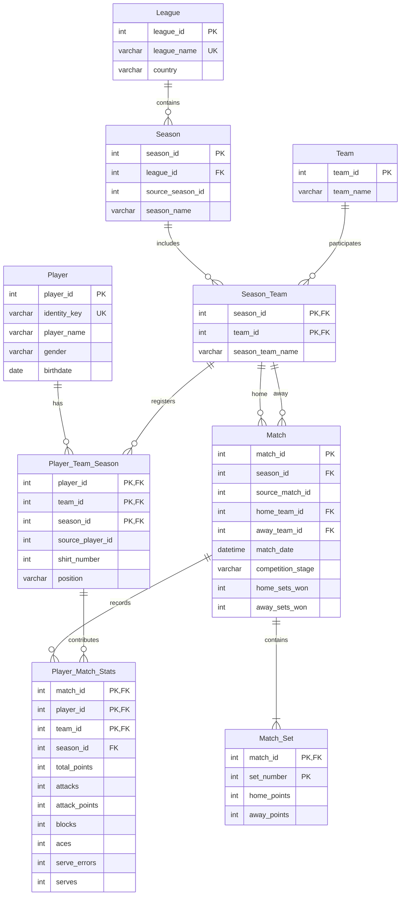

# Volleyball database E-R diagram

Crow's Foot notation: `||` means exactly one, `o{` means zero or many, and `|{` means one or many. Associative tables implement many-to-many relationships. There is no natural one-to-one relationship in this application, so none is invented.

Open [er_diagram.svg](er_diagram.svg) or [er_diagram.png](er_diagram.png) for the rendered diagram.

`Match` maps to SQL table `` `Match` ``. Two role-specific composite foreign keys connect `Match(season_id, home_team_id)` and `Match(season_id, away_team_id)` to `Season_Team`. Stats use composite foreign keys `(match_id, season_id)` and `(player_id, team_id, season_id)`. These are not separate single-column foreign keys.

The database stores source observations without an invented one-to-one relationship. Every imported match has 3–5 sets, verified by `validate_data.py`. A foreign key alone cannot enforce the minimum number of child rows.
