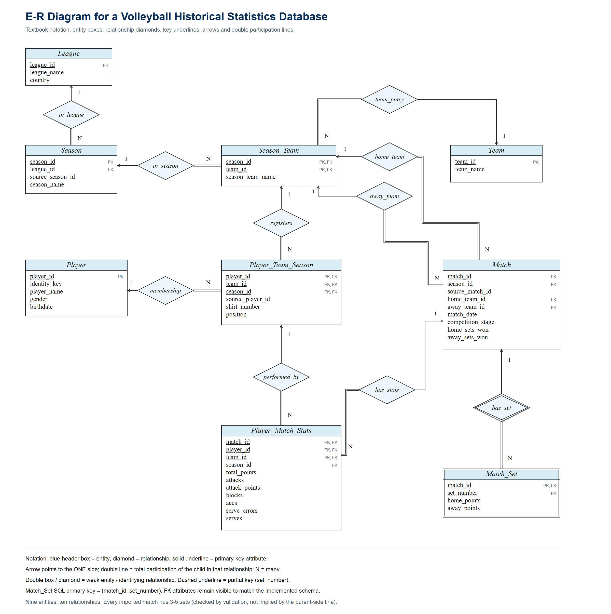
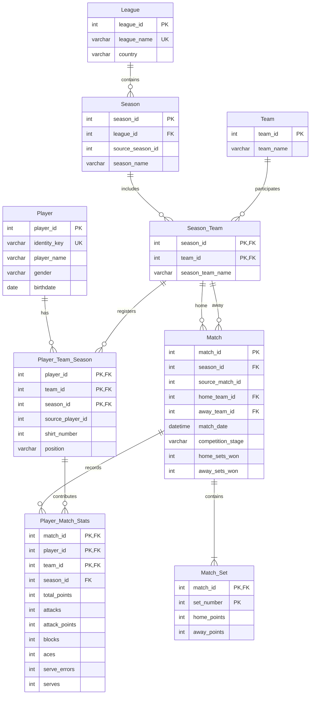

# Volleyball database E-R diagram — textbook notation

This diagram follows the supplied Database System Concepts classroom example: entity boxes with pale blue headers, attributes inside each box, relationship diamonds, underlined keys, arrows toward the one side, and double lines for total participation. All nine implemented tables remain visible.

Open [er_diagram.svg](er_diagram.svg) or [er_diagram.png](er_diagram.png) for the rendered diagram.

For the physical table layout with MySQL types, see [Database Schema](../docs/database_schema.md) and [schema image](database_schema.png).

## How to read this diagram / 圖例

| 符號 | 意義 |
|---|---|
| 淡藍表頭長方形 | 實體，框內列出屬性。 |
| 菱形 | 關係，例如 in_league、home_team、performed_by。 |
| 實線底線 | 主鍵屬性；複合主鍵的多個欄位一起識別一列。 |
| 箭頭與 1 | 指向「一」端，例如多個 Season 對應一個 League。 |
| N | 「多」端；每個 Match 可對應多筆球員統計。 |
| 雙連線 | 該實體對關係完全參與，例如每場 Match 必須有主隊與客隊。 |
| 雙框與雙菱形 | Match_Set 是依賴 Match 識別的弱實體；has_set 是識別關係。 |
| 虛線底線 | set_number 是部分鍵；必須搭配所屬 Match 才能完整識別。 |

`Match_Set` 的實際 SQL 主鍵仍為 `(match_id, set_number)`。圖中保留繼承自所屬 Match 的 match_id，方便與 SQL 對照；set_number 以部分鍵畫法標示。PK/FK 字樣是輔助標示，不取代底線與關係符號。

Single parent-side lines do not assert a minimum number of children. The imported completed matches have 3–5 sets, checked separately by validation. Associative entities Season_Team and Player_Team_Season preserve season participation and transfer history.

## Editable source / 可編輯來源

The main diagram is the vector [er_diagram.svg](er_diagram.svg). Its layout and textbook symbols are generated by [generate_chen_diagram.py](../scripts/generate_chen_diagram.py) using the checked schema metadata. Rebuild SVG and PNG with `python scripts/render_diagram.py`; rendering is local.

## Appendix: Mermaid relationship reference

The following Mermaid source preserves the same entities, fields, and relational connections as a supplementary reference. The submission image above uses the requested textbook symbols.

`Match` maps to SQL table `` `Match` ``. Two role-specific composite foreign keys connect `Match(season_id, home_team_id)` and `Match(season_id, away_team_id)` to `Season_Team`. Stats use composite foreign keys `(match_id, season_id)` and `(player_id, team_id, season_id)`. These are not separate single-column foreign keys.

The database stores source observations without an invented one-to-one relationship. Every imported match has 3–5 sets, verified by `validate_data.py`. A foreign key alone cannot enforce the minimum number of child rows.
