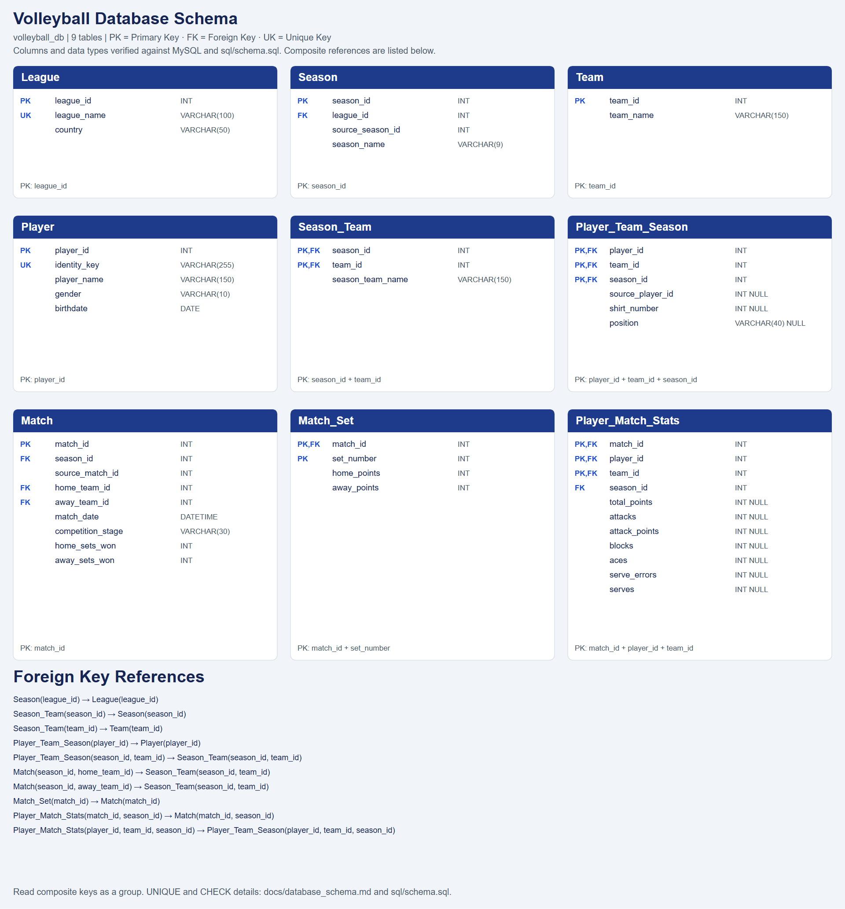

# Database Schema — 排球資料庫結構說明

此文件與圖表依實際 MySQL metadata 產生，並核對 `sql/schema.sql` 的欄位名稱、順序與型別。資料庫名稱：`volleyball_db`。



[開啟可放大 SVG](../diagrams/database_schema.svg) · [完整 ER 關聯圖](../diagrams/er_diagram.md) · [可執行建表 SQL](../sql/schema.sql)

**PK**＝主鍵；**FK**＝外鍵；**UK**＝唯一約束；**NULL**＝允許來源缺值。複合鍵必須整組閱讀，不能拆成各自獨立的鍵。

## 1. League

保存男子與女子聯賽。

```text
League(league_id, league_name, country)
PK: (league_id)
```

| 欄位 | MySQL 型別 | 鍵 | 允許 NULL |
|---|---|---|---|
| league_id | INT | PK | 否 |
| league_name | VARCHAR(100) | UK | 否 |
| country | VARCHAR(50) | — | 否 |

**主鍵：** `(league_id)`。league_id 是穩定編號，不依賴可修改的名稱。

- UNIQUE `(league_name)`。

## 2. Season

保存各聯賽的賽季。

```text
Season(season_id, league_id, source_season_id, season_name)
PK: (season_id)
```

| 欄位 | MySQL 型別 | 鍵 | 允許 NULL |
|---|---|---|---|
| season_id | INT | PK | 否 |
| league_id | INT | FK | 否 |
| source_season_id | INT | — | 否 |
| season_name | VARCHAR(9) | — | 否 |

**主鍵：** `(season_id)`。來源季別在男女聯賽重複，因此使用全域 season_id，並對 league_id＋source_season_id 設唯一約束。

- FK `(league_id)` → `League(league_id)`。
- UNIQUE `(league_id, source_season_id)`。

## 3. Team

保存跨季球隊身分與最新顯示名稱。

```text
Team(team_id, team_name)
PK: (team_id)
```

| 欄位 | MySQL 型別 | 鍵 | 允許 NULL |
|---|---|---|---|
| team_id | INT | PK | 否 |
| team_name | VARCHAR(150) | — | 否 |

**主鍵：** `(team_id)`。沿用來源跨季穩定 team_id，球隊贊助更名不會產生另一支球隊。


## 4. Player

保存依來源解析的球員身分、姓名、性別與生日。

```text
Player(player_id, identity_key, player_name, gender, birthdate)
PK: (player_id)
```

| 欄位 | MySQL 型別 | 鍵 | 允許 NULL |
|---|---|---|---|
| player_id | INT | PK | 否 |
| identity_key | VARCHAR(255) | UK | 否 |
| player_name | VARCHAR(150) | — | 否 |
| gender | VARCHAR(10) | — | 否 |
| birthdate | DATE | — | 否 |

**主鍵：** `(player_id)`。player_id 是獨立代理鍵；來源球衣號碼只在某季某隊有效，不能識別全球球員。

- UNIQUE `(identity_key)`。

## 5. Season_Team

保存球隊參與賽季與當季名稱，解決球隊與賽季的多對多關係。

```text
Season_Team(season_id, team_id, season_team_name)
PK: (season_id, team_id)
```

| 欄位 | MySQL 型別 | 鍵 | 允許 NULL |
|---|---|---|---|
| season_id | INT | PK, FK | 否 |
| team_id | INT | PK, FK | 否 |
| season_team_name | VARCHAR(150) | — | 否 |

**主鍵：** `(season_id, team_id)`。同一隊可參加多季，一季有多隊，所以 season_id＋team_id 合起來才唯一。

- FK `(season_id)` → `Season(season_id)`。
- FK `(team_id)` → `Team(team_id)`。

## 6. Player_Team_Season

保存球員當季所屬球隊、來源編號、球衣與位置，保留轉隊歷史。

```text
Player_Team_Season(player_id, team_id, season_id, source_player_id, shirt_number, position)
PK: (player_id, team_id, season_id)
```

| 欄位 | MySQL 型別 | 鍵 | 允許 NULL |
|---|---|---|---|
| player_id | INT | PK, FK | 否 |
| team_id | INT | PK, FK | 否 |
| season_id | INT | PK, FK | 否 |
| source_player_id | INT | — | 是 |
| shirt_number | INT | — | 是 |
| position | VARCHAR(40) | — | 是 |

**主鍵：** `(player_id, team_id, season_id)`。player_id＋team_id＋season_id 識別一次季別名冊關聯，允許同一球員同季出現在不同隊。

- FK `(player_id)` → `Player(player_id)`。
- FK `(season_id, team_id)` → `Season_Team(season_id, team_id)`。
- UNIQUE `(season_id, team_id, source_player_id)`。
- CHECK：`((`source_player_id` is null) or (`source_player_id` > 0))`。
- CHECK：`((`shirt_number` is null) or (`shirt_number` > 0))`。

## 7. Match

保存比賽日期、階段、主客隊與最終局勝負；時間為德國當地時間。

```text
Match(match_id, season_id, source_match_id, home_team_id, away_team_id, match_date, competition_stage, home_sets_won, away_sets_won)
PK: (match_id)
```

| 欄位 | MySQL 型別 | 鍵 | 允許 NULL |
|---|---|---|---|
| match_id | INT | PK | 否 |
| season_id | INT | FK | 否 |
| source_match_id | INT | — | 否 |
| home_team_id | INT | FK | 否 |
| away_team_id | INT | FK | 否 |
| match_date | DATETIME | — | 否 |
| competition_stage | VARCHAR(30) | — | 否 |
| home_sets_won | INT | — | 否 |
| away_sets_won | INT | — | 否 |

**主鍵：** `(match_id)`。來源比賽編號跨季可能重複，所以使用全域 match_id，同時保留 source_match_id。

- FK `(season_id, home_team_id)` → `Season_Team(season_id, team_id)`。
- FK `(season_id, away_team_id)` → `Season_Team(season_id, team_id)`。
- UNIQUE `(match_id, season_id)`。
- UNIQUE `(season_id, source_match_id)`。
- CHECK：`(`home_team_id` <> `away_team_id`)`。
- CHECK：`(((`home_sets_won` = 3) and (`away_sets_won` between 0 and 2)) or ((`away_sets_won` = 3) and (`home_sets_won` between 0 and 2)))`。

## 8. Match_Set

保存每場比賽依序排列的每局比分。

```text
Match_Set(match_id, set_number, home_points, away_points)
PK: (match_id, set_number)
```

| 欄位 | MySQL 型別 | 鍵 | 允許 NULL |
|---|---|---|---|
| match_id | INT | PK, FK | 否 |
| set_number | INT | PK | 否 |
| home_points | INT | — | 否 |
| away_points | INT | — | 否 |

**主鍵：** `(match_id, set_number)`。每場都有第一局，所以必須用 match_id＋set_number 才能唯一識別一局。

- FK `(match_id)` → `Match(match_id)`。
- CHECK：`(`set_number` between 1 and 5)`。
- CHECK：`((`home_points` >= 0) and (`away_points` >= 0) and (`home_points` <> `away_points`))`。

## 9. Player_Match_Stats

保存一名球員代表一隊在一場比賽中的攻擊、攔網及發球統計。

```text
Player_Match_Stats(match_id, player_id, team_id, season_id, total_points, attacks, attack_points, blocks, aces, serve_errors, serves)
PK: (match_id, player_id, team_id)
```

| 欄位 | MySQL 型別 | 鍵 | 允許 NULL |
|---|---|---|---|
| match_id | INT | PK, FK | 否 |
| player_id | INT | PK, FK | 否 |
| team_id | INT | PK, FK | 否 |
| season_id | INT | FK | 否 |
| total_points | INT | — | 是 |
| attacks | INT | — | 是 |
| attack_points | INT | — | 是 |
| blocks | INT | — | 是 |
| aces | INT | — | 是 |
| serve_errors | INT | — | 是 |
| serves | INT | — | 是 |

**主鍵：** `(match_id, player_id, team_id)`。match_id＋player_id＋team_id 唯一識別球員代表該隊的單場紀錄。

- FK `(match_id, season_id)` → `Match(match_id, season_id)`。
- FK `(player_id, team_id, season_id)` → `Player_Team_Season(player_id, team_id, season_id)`。
- CHECK：`(`total_points` >= 0)`。
- CHECK：`((`attacks` >= 0) and (`attack_points` >= 0) and (`attack_points` <= `attacks`))`。
- CHECK：`((`blocks` >= 0) and (`aces` >= 0) and (`serve_errors` >= 0) and (`serves` >= 0))`。

## 關聯與正規化說明

League → Season 是一對多。Season 與 Team 透過 Season_Team 成為多對多；Player 透過 Player_Team_Season 保留每季的球隊關聯。Match 的主客隊各連到同季的 Season_Team。Match_Set 透過 match_id 連到比賽；Player_Match_Stats 同時連到比賽與球員季別名冊。

Player_Match_Stats.season_id 可以由 match_id 推得，但刻意保留以建立兩組複合外鍵，強制保證比賽與球員名冊賽季一致。這是受約束的少量冗餘，不宣稱所有表嚴格符合 3NF。

每場局數、局勝負、比分合法性及球員是否屬於主客隊，屬於跨列或跨表規則，由匯入交易及 validate_data.py 驗證。一般 CHECK 不能替代這些加總檢查。

重新產生：先啟動 MySQL，再執行 `python scripts/generate_schema_docs.py`。PNG 由 `node scripts/render_schema.cjs` 將 SVG 在本機轉出；需要 Node.js 與 Puppeteer，安裝方式見 README。
