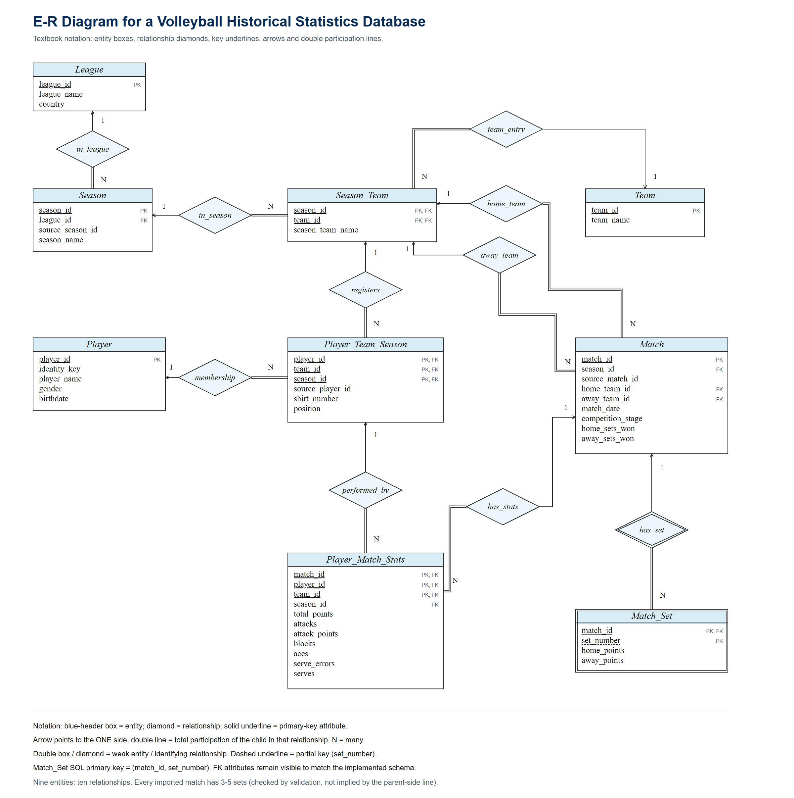
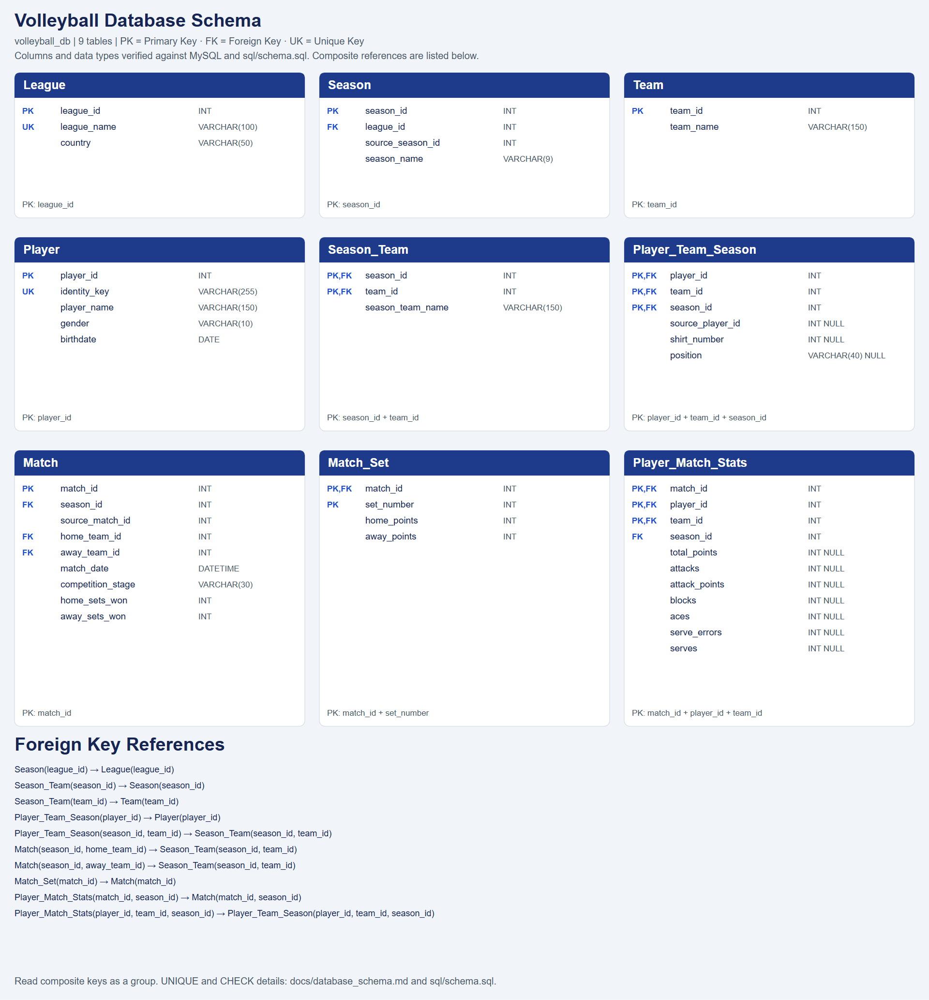

# Final Project Proposal – Part I

**Project:** Volleyball Historical Statistics Database System  
**Course:** Database Systems

## Part 1: Project Descriptions

### 1. Background of the database application

Volleyball records are useful for studying team results and player performance. However, a single spreadsheet often repeats team names, mixes seasons, and makes transfers difficult to track. This project organizes real historical records in a MySQL relational database named `volleyball_db`.

The source is Viktor Bozhinov's [volleystat](https://github.com/bozhinvi/volleystat), pinned to commit `c38586571a6f0d3cc3f42ebb457410020eb8898b`. Its DESCRIPTION declares CC0 and explains that the data was collected from the official German Volleyball Bundesliga website. The project exports four R data frames to CSV using Python. No matches, players, or statistics are invented.

The imported snapshot covers men's and women's leagues from 2013–2014 through 2018–2019: 2 leagues, 12 league-seasons, 32 teams, 940 source-resolved player identities, 1,853 player-team-season records, 1,696 matches, 6,330 sets, and 32,483 accepted player-match statistics.

Data quality matters. Four exact duplicate statistics are removed, and 268 statistics without matching roster identities are quarantined. Missing roster numbers remain NULL. The source player number is unique only within a team and season, so the application assigns a separate player ID using normalized name, gender, and birthdate. Uncertain name changes are not automatically merged. Consequently, player totals describe available, identified records and may be incomplete. The project does not claim to independently verify every historical official match.

### 2. Five useful queries

**Query 1 — Season Team Rankings.** For a selected league-season, combine home and away appearances with UNION ALL and calculate played matches, wins, losses, and win percentage. GROUP BY produces team totals, AVG calculates win percentage, and DENSE_RANK assigns shared ranks. Only the main round is included to avoid giving playoff teams extra league matches. This is an analytical win-rate ranking, not the official Bundesliga points table. In the men's 2018–2019 sample, Hypo Tirol AlpenVolleys Haching has 19 wins, 3 losses, and an 86.36% win rate.

**Query 2 — Player Performance Across Seasons.** Join the selected player to statistics, seasons, and leagues. SUM reports points, attack attempts, attack points, blocks, aces, and service errors. The query also reports recorded matches, average points per recorded match, and weighted attack success: total attack points divided by total attack attempts. For Robert Kromm, the database returns five seasons. His recorded total points change from 357 in 2013–2014 to 259 in 2017–2018. A missing season is not interpreted as zero performance.

**Query 3 — Head-to-Head Match History.** Find both home-away arrangements for two teams, join their seasonal names, and show season, local match time, stage, final set score, and winner. ORDER BY arranges the history chronologically. Berlin Recycling Volleys and VfB Friedrichshafen have 37 recorded meetings in this snapshot.

**Query 4 — Top Performing Players.** Group identified statistics by player for a selected season and sum attack points, block points, and aces. Window functions rank all players in each category. The displayed top ten are selected by attack points; the block and ace ranks are calculated over the full player population before this limit. In the men's 2018–2019 sample, Sebastian Gevert leads the accepted attack-point records with 399 and also has 47 aces. Totals are influenced by the number of recorded appearances and by quarantine exclusions.

**Query 5 — Five-Set Match Analysis.** First list each five-set match, its teams, ordered set scores, final score, and winner. Then calculate five-set counts and percentages for each league-season. The denominator includes all recorded matches in that league-season, including playoffs. There are 348 five-set matches overall. Men's 2018–2019 has 38 of 155 matches, or 24.52%. GROUP_CONCAT orders set scores by set number, while COUNT, SUM, and AVG summarize the proportions.

The exact executable MySQL statements are in [queries.sql](../sql/queries.sql). Actual execution results and complete CSV outputs are in [query_results.md](query_results.md) and `query_results/`.

### 3. Explanation of the E-R design

The design separates leagues, seasons, teams, players, memberships, matches, sets, and statistics. A league has many seasons. Seasons and teams have a many-to-many relationship resolved by Season_Team. Players belong to teams within seasons through Player_Team_Season. A player can therefore transfer without overwriting earlier memberships, including membership in more than one team during a season. The data does not provide reliable transfer dates, so the system does not invent exact membership intervals.

A match has one home team, one away team, and several ordered sets. The two team roles reference the participating teams in the same season. Statistics connect a match with a registered player and team. The diagram uses the textbook E-R notation from the classroom example: entity boxes containing attributes, Chen-style relationship diamonds, underlined keys, arrows toward the one side, and double participation lines. There is no natural one-to-one relationship, so the diagram does not add an artificial one.

The core tables follow normalization principles by separating entities and resolving many-to-many relationships. One deliberate exception is season_id in Player_Match_Stats: it is determined by match_id but retained to enforce both match-season and player-team-season consistency through composite foreign keys. This is a documented, constrained redundancy rather than a claim of strict 3NF for every table. Position and historical team names are stored at the season level, where they can change.

## Part 2: E-R Diagram

The symbol legend, key labels, composite-key notes, editable source links, and supplementary Mermaid reference are in [er_diagram.md](../diagrams/er_diagram.md). A scalable [SVG](../diagrams/er_diagram.svg) is also provided. PK means primary key and FK means foreign key. The diagram represents all nine SQL tables. Match_Set is drawn as a weak entity with an identifying has_set relationship; set_number is its partial key. Its SQL primary key combines match_id and set_number. Double lines indicate total participation of the child. Every imported match has 3–5 sets; the parent-side single line does not assert this minimum, which is checked by the validation program.

## Part 3: Database Schema

The [complete schema reference](database_schema.md) lists each column's type, nullability, primary key, foreign keys, unique constraints, CHECK constraints, and the reason for choosing each primary key. The diagram is generated from live MySQL metadata and checked against the SQL definitions.

The implementation uses MySQL 8.x, InnoDB, and utf8mb4. `Match` is quoted with backticks in SQL to avoid keyword conflicts. The complete DDL and CHECK expressions are in [schema.sql](../sql/schema.sql).

| Table | Columns | Primary key and purpose |
|---|---|---|
| League | league_id, league_name, country | league_id identifies the men's or women's competition independently of its name. |
| Season | season_id, league_id, source_season_id, season_name | season_id is a global surrogate key because the source season code repeats across leagues. |
| Team | team_id, team_name | team_id reuses the source's stable team identifier, preserving identity across sponsorship name changes. |
| Player | player_id, identity_key, player_name, gender, birthdate | player_id is a surrogate identity key independent of shirt number and team. |
| Season_Team | season_id, team_id, season_team_name | (season_id, team_id) identifies one team's participation and historical name in one season. |
| Player_Team_Season | player_id, team_id, season_id, source_player_id, shirt_number, position | (player_id, team_id, season_id) represents one seasonal membership and preserves transfers. |
| Match | match_id, season_id, source_match_id, home_team_id, away_team_id, match_date, competition_stage, home_sets_won, away_sets_won | match_id is a global surrogate key because source match numbers repeat across seasons. |
| Match_Set | match_id, set_number, home_points, away_points | (match_id, set_number) identifies an ordered set inside a match. |
| Player_Match_Stats | match_id, player_id, team_id, season_id, total_points, attacks, attack_points, blocks, aces, serve_errors, serves | (match_id, player_id, team_id) identifies a player's recorded performance for one team in a match. |

**Foreign keys.** Season.league_id references League. Season_Team references Season and Team. Player_Team_Season references Player and the composite Season_Team key. Match uses two composite references to Season_Team for the home and away roles. Match_Set references Match. Player_Match_Stats references Match through (match_id, season_id) and Player_Team_Season through (player_id, team_id, season_id). These composite keys prevent a statistic from silently linking a player's membership in the wrong season.

**Unique constraints.** League names and Player.identity_key are unique. Season has UNIQUE(league_id, source_season_id), Match has UNIQUE(season_id, source_match_id), and roster records have UNIQUE(season_id, team_id, source_player_id). Nullable source roster IDs are retained when absent. Match also exposes UNIQUE(match_id, season_id) for the composite foreign key.

**Checks and import validation.** Teams in a match must differ. Completed matches must end 3–0, 3–1, or 3–2 in either direction. Set numbers must be 1–5, points must be nonnegative, and set scores cannot tie. Stored count statistics must be nonnegative, and attack points cannot exceed attempts. The import transaction additionally checks foreign-key orphans, actual participating teams, continuous set numbers, agreement between sets and final results, legal completed-set scores, and scoring components. A failed check rolls back the data transaction. MySQL schema creation uses separate implicit DDL commits.

**Reproducibility.** The import follows parent-before-child order, uses upserts, and prints row counts. Importing the fixed snapshot twice produced identical counts. Ten validation checks returned zero violations on MySQL 8.4.13. Python reads credentials from a local .env file; passwords and database files are excluded from Git.
