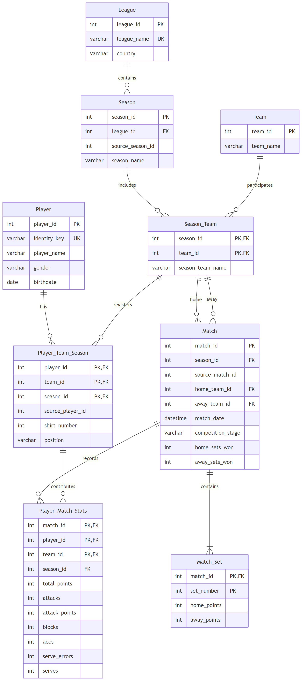

# 期末企劃書 Part I：繁體中文理解版

專題名稱：排球歷史賽事與球員數據管理系統。

## Part 1：專題介紹

### 1. 背景與目的

我們把德國排球聯賽六個歷史賽季的真實資料整理進 MySQL，方便查球隊勝率、球員歷年表現、歷史交手與五局大戰。資料來自 [volleystat](https://github.com/bozhinvi/volleystat)，不是自行編造。

資料含男女聯賽，2013–2014 到 2018–2019。實際匯入 2 個聯賽、12 個聯賽賽季、32 支球隊、940 個可解析球員身分、1,853 筆球員所屬球隊賽季、1,696 場比賽、6,330 局與 32,483 筆單場球員統計。

原始資料是 R 套件的 RDA，不是 CSV；我們用 Python 轉出 CSV。四筆完全重複統計去重，268 筆沒有對應名冊的統計隔離保存，沒有補假姓名。詳細來源、授權與缺值見 [data_sources.md](data_sources.md)。

### 2. 五個有用的查詢

| 查詢 | 白話問題 | 使用方法 | 實際例子 |
|---|---|---|---|
| Q1 球隊排名 | 這一季哪隊勝率最高？ | 合併主客場、加總勝負、AVG 算勝率、DENSE_RANK 排名 | 男子 2018–2019，Haching 19 勝 3 敗，86.36%。 |
| Q2 球員跨季表現 | 同一球員每季得分是否改變？ | 球員 JOIN 統計與賽季，SUM 得分、攻擊、攔網與 Ace | Robert Kromm 有五季紀錄；第一季 357 分，最後有紀錄的一季 259 分。 |
| Q3 歷史交手 | 兩隊以前打過幾場、誰贏？ | 同時找 A 主場與 B 主場，依日期排序 | Berlin 與 Friedrichshafen 有 37 場交手。 |
| Q4 最佳球員 | 哪位球員攻擊得分最多？ | 每人加總，計算攻擊、攔網與 Ace 排名 | 男子 2018–2019，Sebastian Gevert 攻擊得分 399、Ace 47。 |
| Q5 五局大戰 | 哪些比賽打滿五局？哪季最多？ | 串接每局比分，計算五局場數除以總場數 | 全部 348 場；男子 2018–2019 為 38/155＝24.52%。 |

Q1 只看例行賽，依勝率與勝場排，並列共用名次，**不是官方德甲積分榜**。其他查詢看全部階段。球員統計因隔離紀錄可能不完整；沒有某季紀錄不代表該季得 0 分。Q4 的前十名是「攻擊得分前十」，同時附上各自在全部球員中的攔網、Ace 排名。

### 3. 為什麼要這樣設計 ER 圖？

聯賽底下有多個賽季；球隊可以參加多季，每季也有多隊，所以需要 Season_Team 中間表。球員可以換隊，不能在 Player 只放一個 team_id，所以用 Player_Team_Season 保留「誰、哪隊、哪季」。同一季有兩隊的紀錄也可以保存；來源沒有可靠的轉隊日期，不虛構起訖日。

一場比賽有主隊與客隊，並有三到五局。每局只保存一次，透過 match_id 連回比賽。球員單場統計另外存，避免把球員所有資料在每一場反覆複製。

球員原始 ID 是當季當隊的號碼，不能當全世界唯一 ID。我們以正規化姓名、性別與生日建立獨立 ID。名字不同但生日相同也不隨便合併，因為可能是不同人或雙胞胎；未確認的改名仍是限制。

## Part 2：E-R Diagram

Mermaid 原始碼與完整說明：[er_diagram.md](../diagrams/er_diagram.md)。使用 Crow's Foot（烏鴉腳）模型：直線代表一，分叉代表多。這個應用沒有必要的一對一關係，不會為了畫圖硬造一張表。

## Part 3：資料庫 Schema

| 表 | 用途 | 主鍵為什麼這樣選 |
|---|---|---|
| League | 男子、女子兩種聯賽 | league_id 穩定，不怕名稱修改。 |
| Season | 每個聯賽的某一季 | season_id 必須含聯賽差異，男女同年不是同一季。 |
| Team | 球隊身分與最新顯示名稱 | 沿用來源跨季穩定 team_id，不因贊助更名分裂。 |
| Player | 球員身分、姓名、性別、生日 | 自建 player_id，不拿球衣號碼當全球識別。 |
| Season_Team | 球隊參加哪一季、當時隊名 | season_id＋team_id，同隊一季一筆。 |
| Player_Team_Season | 當季所屬球隊、來源編號、球衣與位置 | player_id＋team_id＋season_id，允許跨季轉隊與同季不同隊。 |
| Match | 比賽日期、階段、主客隊與局勝負 | 自建 match_id，避免不同季重複的來源編號撞號。 |
| Match_Set | 每場每局主客比分 | match_id＋set_number，第一局只在該場內唯一。 |
| Player_Match_Stats | 球員那一場的得分、攻擊、攔網、發球 | match_id＋player_id＋team_id，表示誰替哪隊打哪場。 |

所有欄位與型別以 [schema.sql](../sql/schema.sql) 為準，英文企劃書 Part 3 也逐表列出完整欄位。外鍵關係如下：

- Season → League。
- Season_Team → Season、Team。
- Player_Team_Season → Player，以及 Season_Team 的複合鍵。
- Match 的「賽季＋主隊」、「賽季＋客隊」都 → Season_Team。
- Match_Set → Match。
- Player_Match_Stats 的「比賽＋賽季」→ Match；「球員＋球隊＋賽季」→ Player_Team_Season。

核心設計盡量正規化。不過統計表的 season_id 可以由 match_id 得知，我們刻意保留它，讓兩組複合外鍵能保證「球員名冊賽季＝比賽賽季」。這是少量、受約束的冗餘，不能向老師說每張表都嚴格完全符合 3NF。

CHECK 限制主客不同、合法的 3 比幾結果、局號與非負統計；跨多列的規則，例如每場所有局加起來是否符合最終勝負，由匯入與驗證程式負責。實際在 MySQL 8.4.13 跑過，十項檢查全部為 0；同一資料重跑匯入，列數不增加。

報告練習請看 [report_guide_zh.md](report_guide_zh.md)。
